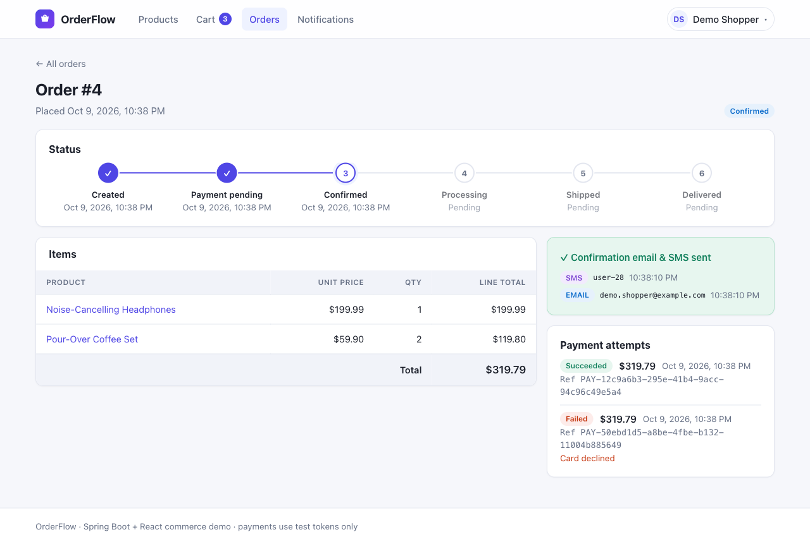
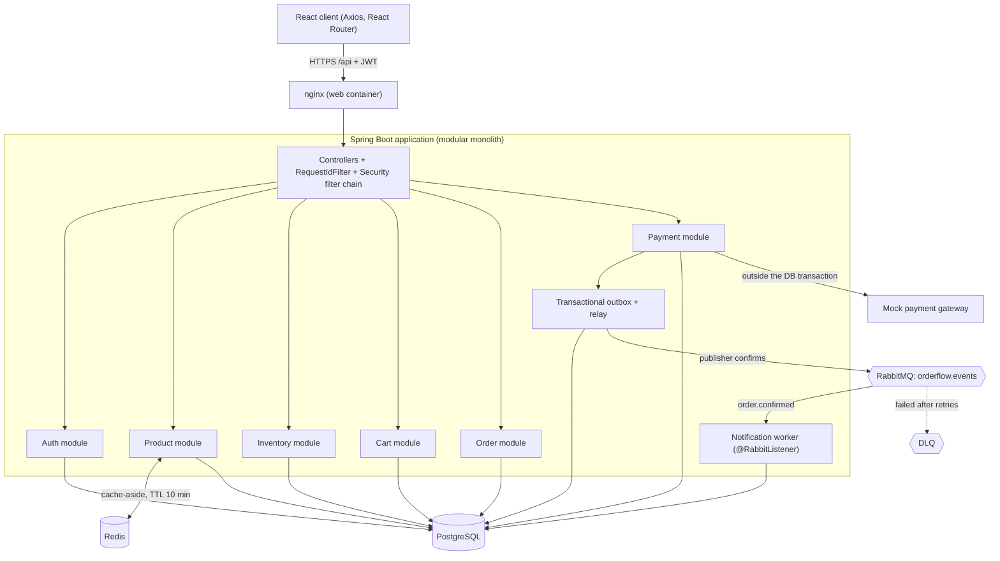
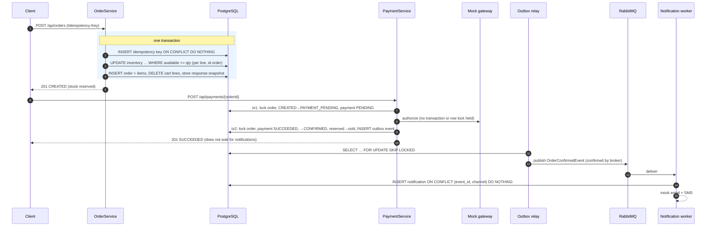
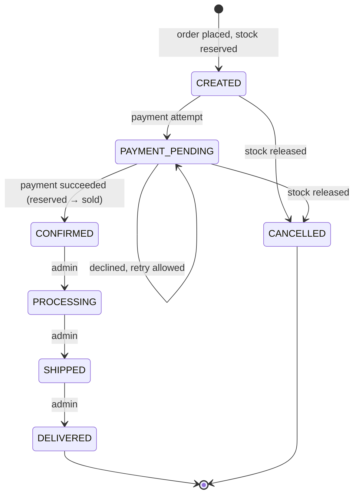
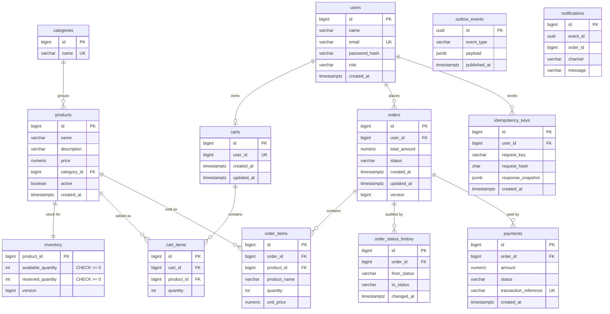
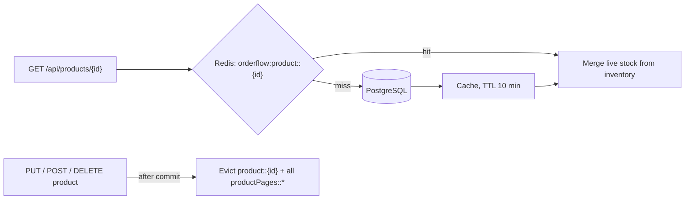
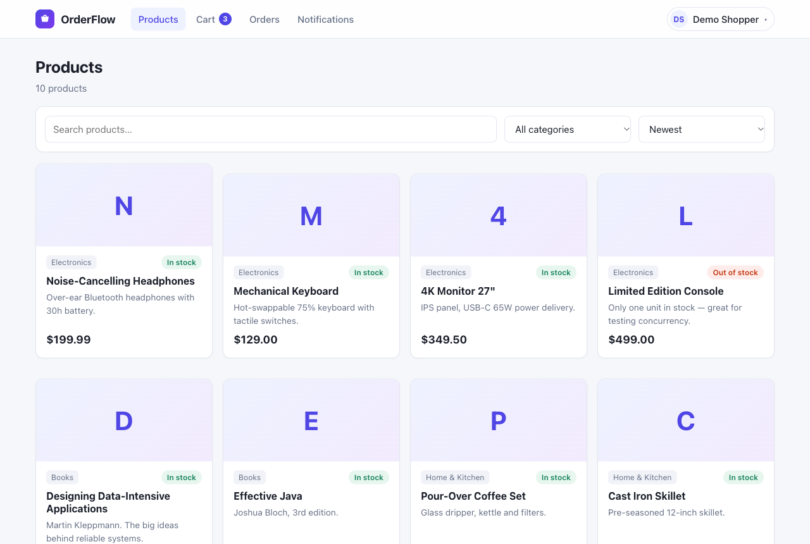
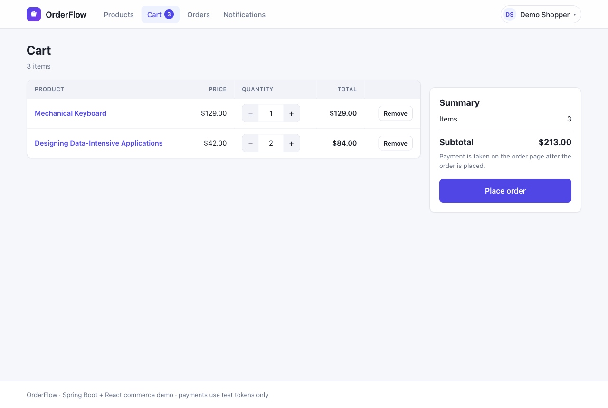
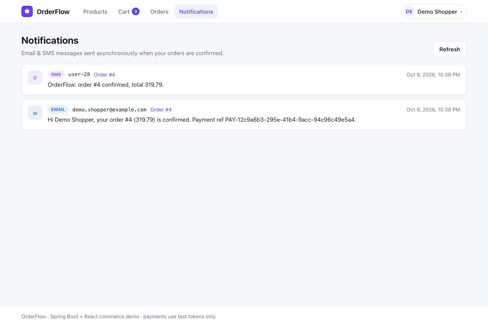

# OrderFlow — Distributed Order & Inventory Platform

A production-style commerce backend with a React client. It covers transactional order workflows,
**concurrency-safe inventory**, **idempotent order creation**, **Redis caching**, **asynchronous processing with
RabbitMQ**, JWT authentication, automated tests and a Docker Compose deployment.

It is built as a **modular Spring Boot monolith**. Each business module (auth, product, inventory, cart, order,
payment, notification) owns its controller → service → repository → entity/DTO stack. Modules refer to each other's
data by ID only, so they can be split into services later (see [Future decomposition](#known-limitations--future-microservice-decomposition)).

| Layer | Technology |
|---|---|
| Frontend | React 18 (JavaScript), Axios, React Router, Vite |
| Backend | Java 25 LTS, Spring Boot 3.5, Spring Security (OAuth2 resource server, HS256 JWT), Spring Data JPA |
| Database | PostgreSQL 16, Flyway migrations |
| Cache | Redis 7 (Spring Cache) |
| Messaging | RabbitMQ 3.13 (topic exchange, DLQ, transactional outbox) |
| Testing | JUnit 5, Mockito, Spring Boot Test, Testcontainers, Vitest |
| API testing | Postman collection (run with Newman) |
| Infrastructure | Docker, Docker Compose, Git |



---

## Quick start (Docker Compose)

```bash
cp .env.example .env          # then replace every secret in .env
docker compose up -d --build
```

| URL | What |
|---|---|
| http://localhost:3000 | React app (nginx; proxies `/api` to the backend) |
| http://localhost:8080/swagger-ui.html | OpenAPI / Swagger UI |
| http://localhost:8080/actuator/health | Health (liveness/readiness) |
| http://localhost:15672 | RabbitMQ management UI |

You can change ports in `.env` with `APP_PORT`, `WEB_PORT`, `POSTGRES_PORT`, `REDIS_PORT` and `RABBITMQ_PORT`.
The demo catalogue includes a **Limited Edition Console with exactly one unit**, for trying the concurrency demo.
An admin account is created from `ADMIN_EMAIL` / `ADMIN_PASSWORD` on first start.

**Environment variables** (blueprint §11): `DATABASE_URL`, `DATABASE_USERNAME`, `DATABASE_PASSWORD`, `REDIS_HOST`,
`RABBITMQ_HOST`, `RABBITMQ_USERNAME`, `RABBITMQ_PASSWORD`, `JWT_SECRET` (≥ 32 bytes; the app refuses to start
otherwise), `ADMIN_EMAIL`, `ADMIN_PASSWORD`, `CORS_ALLOWED_ORIGINS`, `FLYWAY_LOCATIONS`. Only `.env.example` is
committed; `.env` is git-ignored.

### Local development

```bash
docker compose up -d postgres redis rabbitmq
cd backend && JWT_SECRET=$(openssl rand -base64 48) mvn spring-boot:run   # API on :8080
cd frontend && npm install && npm run dev                                # UI on :5173, proxies /api
```

### Tests

```bash
cd backend && mvn verify      # 73 unit tests + 67 integration tests (needs Docker for Testcontainers)
cd frontend && npm test -- --run
```

---

## Architecture



Inside each module the layering is **Controller → Service → Repository → Database**. DTOs and mappers sit at the
edge, Bean Validation checks input, and one `GlobalExceptionHandler` turns every failure into the same envelope:

```json
{ "success": false, "error": { "code": "OUT_OF_STOCK", "message": "Insufficient stock for product 4" },
  "requestId": "0053715c-58e2-4c4a-918c-d8548a551e94", "timestamp": "2026-10-09T16:32:07Z" }
```

The `X-Request-Id` header is accepted from the client or generated. It goes into the MDC, so it appears on every
log line, and is echoed on the response. It is also carried through the outbox into the RabbitMQ message headers,
so one checkout can be traced across threads:

```
INFO [0053715c-…] [http-nio-exec-10] PaymentService         : Payment 2 succeeded; order 1 confirmed
INFO [0053715c-…] [ntContainer#0-1]  OrderConfirmedConsumer : Received OrderConfirmedEvent 007f30ed-… for order 1
INFO [0053715c-…] [ntContainer#0-1]  NotificationSender     : [MOCK-EMAIL] to=asha@example.com message="Hi Asha, …"
```

### Request flow: checkout



### Order state machine



`OrderStatus.allowedNext()` defines the only legal transitions. `Order.transitionTo()` is the only way to change
status, and it records every change in `order_status_history`. Any other transition returns
`409 INVALID_STATE_TRANSITION`. For example, a `DELIVERED` (or `CONFIRMED`) order cannot be cancelled.
`PAYMENT_PENDING` and `CONFIRMED` are driven only by payments; admins can set only `PROCESSING`, `SHIPPED` and
`DELIVERED`.

---

## Database design (ER diagram)



The schema is in [`V1__init_schema.sql`](backend/src/main/resources/db/migration/V1__init_schema.sql). Hibernate
runs with `ddl-auto=validate`, so Flyway is the only thing that changes the schema. The database also enforces
invariants as a second line of defence:
- `CHECK (available_quantity >= 0)`.
- Partial unique indexes allow at most one `PENDING` and one `SUCCEEDED` payment per order.
- `UNIQUE (user_id, request_key)` on idempotency keys.
- `UNIQUE (event_id, channel)` on notifications.

---

## Critical engineering implementations

### 1. Concurrency-safe inventory (blueprint §8.1)

Stock changes are **single conditional `UPDATE` statements**
([`InventoryRepository`](backend/src/main/java/com/orderflow/inventory/repository/InventoryRepository.java)):

```sql
UPDATE inventory
   SET available_quantity = available_quantity - :qty,
       reserved_quantity  = reserved_quantity + :qty,
       version = version + 1
 WHERE product_id = :productId AND available_quantity >= :qty;
```

If the update affects 0 rows, the service throws `OutOfStockException` (`409 OUT_OF_STOCK`) and the whole order
transaction rolls back, including lines that were already reserved. When two transactions race for the last unit,
PostgreSQL makes the second one wait on the row lock. After the first commits, the second re-checks the `WHERE`
clause and updates nothing.

Multi-item orders reserve lines in **ascending product-id order**, so two orders that hold opposite products can't
deadlock. Admin stock corrections use **optimistic locking** on `version`: a stale `expectedVersion` returns
`409 STALE_INVENTORY_VERSION`.

**Integration test results**
([`ConcurrentInventoryIT`](backend/src/test/java/com/orderflow/inventory/ConcurrentInventoryIT.java)). Requests go
through real HTTP and are released together by a latch:

| Scenario | Result |
|---|---|
| 20 buyers, stock 1 | exactly **1 × 201, 19 × 409**; available 0, reserved 1, 1 order |
| 30 buyers, stock 10 | exactly **10 × 201, 20 × 409**; 10 units ordered, never negative |
| 20 orders for products [A,B] and [B,A] together | **20 × 201**, no deadlock (no 500s) |
| Cancel racing 10 new orders | `available + reserved` is still the initial stock |

**Live run against the Docker Compose stack**
([`scripts/concurrency-demo.sh`](scripts/concurrency-demo.sh)):

```
$ scripts/concurrency-demo.sh http://localhost:3000 25
Product 4 ('Limited Edition Console') available before: 1
Firing 25 concurrent orders for 1 unit each...
HTTP status distribution:
      1 201
     24 409
Available after: 0 (never negative)
```

### 2. Idempotent order creation (blueprint §8.2)

`POST /api/orders` requires an `Idempotency-Key` header of 8–100 characters
([`IdempotencyService`](backend/src/main/java/com/orderflow/common/idempotency/IdempotencyService.java)). Inside
the order transaction the key is claimed with `INSERT … ON CONFLICT DO NOTHING`, together with a SHA-256 hash of
the normalised request (lines merged and sorted). The response snapshot is stored in the same transaction.

| Case | Behaviour |
|---|---|
| First request | Order created; key, order, reservation and snapshot commit atomically. `Idempotent-Replayed: false` |
| Retry with the same key and body | Original response replayed (same order id); no new order, no stock taken. `Idempotent-Replayed: true` |
| Concurrent duplicates (double click) | The second `INSERT` blocks on the unique index until the first commits, then replays. **15 parallel requests → 1 order** |
| Same key, different body | `422 IDEMPOTENCY_KEY_REUSED` |
| First attempt failed (e.g. out of stock) | Key rolled back with it, so a retry is evaluated again rather than replaying the error |
| Key scope / lifetime | Per user; purged after 24 h by a scheduled job |

```bash
curl -X POST $API/api/orders -H "Authorization: Bearer $T" -H "Idempotency-Key: 7f6c1e0a-checkout-1" \
     -H 'Content-Type: application/json' -d '{"items":[{"productId":1,"quantity":2}]}'
# → 201 {"data":{"id":1,"status":"CREATED","totalAmount":399.98,…}}   Idempotent-Replayed: false
# Same command again (e.g. client timed out and retried):
# → 201 {"data":{"id":1,…}}                                             Idempotent-Replayed: true
```

The React client creates one key per checkout attempt and reuses it when retrying after a network error. It only
creates a new key when the cart changes or after a successful order.

### 3. Redis caching (blueprint §8.3)



- **What is cached:** product details (`product::{id}`) and product list pages (`productPages::c=…|q=…|s=…|p=…|n=…`).
  Each cache has a typed JSON serializer and a 10-minute TTL (`PRODUCT_CACHE_TTL`).
- **Stock is never cached.** It is merged in live from `inventory`, so the cache can't show stale availability or
  cause overselling.
- **Invalidation:** every product write evicts the detail entry and all list pages. The cache manager is
  transaction-aware, so evictions run *after commit* and a concurrent reader can't re-cache pre-commit data.
  Clearing list pages uses `SCAN`, not `KEYS`.
- **Measured hit behaviour** ([`ProductCacheIT`](backend/src/test/java/com/orderflow/product/ProductCacheIT.java)):
  10 reads produce **1 miss + 9 hits**. After a direct DB change the cached value is still served, and a write
  through the API evicts it. Statistics are exposed at `/actuator/metrics/cache.gets?tag=name:product&tag=result:hit`
  (admin only). On the live stack after the Newman run that showed 21 hits, 6 misses and a TTL of 600 s.

### 4. RabbitMQ asynchronous workflow (blueprint §8.4)

```
Payment succeeded ──(same DB tx)──► outbox_events row
                                        │  relay every 1s, FOR UPDATE SKIP LOCKED, publisher confirms
                                        ▼
                      exchange orderflow.events (topic) ── order.confirmed ──► queue notification.order-confirmed
                                                                                    │ 3 attempts, then
                                                                                    ▼ dead-letter
                                       OrderConfirmedConsumer (mock email + SMS)    notification.order-confirmed.dlq
```

- **No lost events:** the event is written in the same transaction as the `CONFIRMED` status (transactional outbox),
  so a broker outage delays it rather than losing it.
- **Non-blocking:** the payment request returns as soon as tx2 commits. The test
  `orderConfirmationDoesNotWaitForTheNotificationConsumer` stops the listener: the payment still returns 201, and the
  event waits in the durable queue until the listener restarts.
- **At-least-once delivery, exactly-once effect:** the consumer de-duplicates on `(event_id, channel)`. Re-publishing
  the same event twice sends nothing new.
- **Poison messages:** malformed JSON, or events that keep failing, go to the DLQ after retries (tested).
- **Decoupled contract:** messages carry no Java class headers. The consumer infers the type from its method
  signature, so the worker can move to another service unchanged.

### 5. Transactions (blueprint §8.5)

| Operation | Transaction boundary |
|---|---|
| Create order | **One** tx: idempotency key + all reservations + order/items + cart cleanup + response snapshot |
| Cancel order | **One** tx: `SELECT … FOR UPDATE` on the order, state change, stock release |
| Pay | **Two** short txs around the gateway call. The slow external call holds no DB connection or lock. tx2 records the result, confirms the order, converts reserved stock to sold and writes the outbox event atomically |
| Notification | Consumer tx: insert notification (deduped) then send. A failure rolls back and the message is redelivered |

Helper operations that must run inside a caller's transaction (`InventoryService.reserve/release/commit`,
`IdempotencyService`, `OutboxService`, `CartService.removeProducts`) are declared
`@Transactional(propagation = MANDATORY)`. Calling them outside a transaction fails immediately instead of silently
running without one.

Payment retry safety:
- If the order is already paid, the existing payment is returned (`200`) and nothing is charged.
- A concurrent attempt gets `409 PAYMENT_IN_PROGRESS`. **10 parallel pay requests → 1 charge.**
- If the order is cancelled while the gateway call is in flight, the authorisation is `VOIDED` instead of captured.
- Payments stuck `PENDING` after a crash are failed after 5 minutes so the customer can retry.

---

## API

The full OpenAPI spec is at `/swagger-ui.html`. A Postman collection and environment are in [`postman/`](postman/).

| Method | Endpoint | Purpose | Auth |
|---|---|---|---|
| POST | `/api/auth/register` | Create user (returns JWT) | public |
| POST | `/api/auth/login` | Authenticate | public |
| GET | `/api/auth/me` | Current user | user |
| GET | `/api/categories` | List categories | public |
| POST | `/api/categories` | Create category | admin |
| GET | `/api/products?page&size&categoryId&q&sort` | Paginated product list (live stock) | public |
| GET | `/api/products/{id}` | Product details | public |
| POST | `/api/products` | Create product with initial stock | admin |
| PUT | `/api/products/{id}` | Update name/price/category/active | admin |
| DELETE | `/api/products/{id}` | Deactivate product | admin |
| GET / POST / PUT | `/api/inventory/{productId}`, `…/restock` | View, restock, optimistic adjust | admin |
| POST | `/api/cart/items` | Add item | user |
| GET | `/api/cart` | Get current cart | user |
| PATCH | `/api/cart/items/{id}` | Change quantity | user |
| DELETE | `/api/cart/items/{id}` | Remove item | user |
| POST | `/api/orders` | Create order; **requires `Idempotency-Key`** | user |
| GET | `/api/orders/{id}` | Get order (owner or admin) | user |
| GET | `/api/orders` | List user's orders | user |
| POST | `/api/orders/{id}/cancel` | Cancel eligible order | user |
| POST | `/api/payments/{orderId}` | Mock payment (`paymentToken`: `tok_visa`, `tok_declined`, `tok_insufficient_funds`, `tok_gateway_error`) | user |
| GET | `/api/payments/{orderId}` | Payment attempts | user |
| GET | `/api/notifications` | Notifications sent to the user | user |
| GET | `/api/admin/orders?status` | All orders | admin |
| PATCH | `/api/admin/orders/{id}/status` | Fulfilment transition | admin |

Status codes used:
- `400` validation failure, malformed request or missing `Idempotency-Key`
- `401` unauthenticated
- `403` forbidden
- `404` not found; other users' resources also return 404 so IDs can't be probed
- `409` out of stock, invalid transition, payment in progress
- `422` business-rule violation or idempotency-key reuse
- `402` payment declined

### Postman / Newman result (against the Docker Compose stack, through nginx)

```
┌─────────────────────────┬───────────────────┬──────────────────┐
│                         │          executed │           failed │
├─────────────────────────┼───────────────────┼──────────────────┤
│                requests │                55 │                0 │
│            test-scripts │               110 │                0 │
│              assertions │               158 │                0 │
└─────────────────────────┴───────────────────┴──────────────────┘
```

Reproduce with:

```bash
npx newman run postman/OrderFlow.postman_collection.json -e postman/OrderFlow.local.postman_environment.json \
  --env-var baseUrl=http://localhost:3000 --env-var adminEmail=… --env-var adminPassword=…
```

---

## Testing

There are **140 backend tests** (73 unit, 67 integration) and **22 frontend tests**. Integration tests use
**Testcontainers** to run real PostgreSQL 16, Redis 7 and RabbitMQ 3.13, all sharing one Spring context. The full
`mvn verify` takes about 30 s. Details are in [docs/TEST_RESULTS.md](docs/TEST_RESULTS.md).

| Blueprint §10 requirement | Tests |
|---|---|
| Unit tests: pricing, state transitions, validation, service logic | `PricingServiceTest`, `OrderStatusTest`, `OrderTest`, `RequestValidationTest`, `OrderServiceTest`, `PaymentServiceTest`, `AuthServiceTest`, `InventoryServiceTest`, `NotificationServiceTest` |
| Repository/integration tests against PostgreSQL | `InventoryRepositoryIT` (`@DataJpaTest`), all `*IT` |
| Authentication & authorization | `AuthApiIT` (register/login, BCrypt, tampered/expired JWT, 401/403) |
| Concurrent inventory: stock never negative | `ConcurrentInventoryIT` |
| Idempotency: no duplicate orders | `IdempotencyIT` (sequential, concurrent, mismatch, failed attempt, purge) |
| Redis cache behaviour | `ProductCacheIT` (hits/misses, TTL, eviction, live stock) |
| RabbitMQ consumer for OrderConfirmedEvent | `PaymentAndNotificationIT` (async delivery, non-blocking, dedupe, DLQ) |
| API: success, validation, 401, 404, 409 | `ProductApiIT`, `CartApiIT`, `OrderApiIT`, `InventoryApiIT` + the Postman collection |

---

## Screenshots

| Catalogue | Cart |
|---|---|
|  |  |
| **Order detail** (timeline, payment attempts, async notifications) | **Notifications** |
|  |  |

## Deployment

The complete stack runs with `docker compose up` (5 containers, all with health checks):
- The backend image is multi-stage with layered jars, runs as a non-root user and uses container-aware JVM memory
  settings.
- The frontend is served by nginx with SPA fallback and immutable asset caching.

**Deployed URL:** this repository is not deployed to a public host yet. The same Compose file runs on any Docker
host (e.g. a small VM). On a managed platform you would point the env vars at managed PostgreSQL, Redis and
RabbitMQ. Add the URL here once it is deployed.

---

## Known limitations & future microservice decomposition

**Limitations (deliberate scope cuts)**
- The payment gateway is a deterministic mock. A real provider would also need webhooks and provider-side
  idempotency keys, and stale-payment recovery would query the provider before failing a payment.
- Notifications are logged, not sent (`NotificationSender` is the adapter seam for SES, Twilio, etc.).
- There is no refresh token or token revocation (access tokens last 2 h), and no rate limiting or login
  brute-force protection.
- Stock is reserved at order creation and released on cancel. Unpaid orders are not auto-expired yet (a scheduled
  "expire CREATED orders after N minutes" job would do it).
- The outbox relay polls every second. CDC (Debezium) would remove the polling delay at higher scale.
- Admin listing of all orders uses offset pagination; keyset pagination would scale better.

**Decomposition path**

The module boundaries already match the services they would become:

| Future service | Owns | Integration |
|---|---|---|
| Identity | users | Issues JWTs; other services only validate them (already stateless) |
| Catalog | categories, products, Redis cache | Read-heavy, scales independently |
| Inventory | inventory | Reservation API (`reserve/release/commit` already exist as one service interface) |
| Ordering | carts, orders, idempotency | Orchestrates the checkout saga |
| Payments | payments, outbox | Publishes `OrderConfirmedEvent` (already event-driven) |
| Notifications | notifications | Already a separate consumer with a broker-only contract |

The main change would be replacing today's single-database transaction (reserve stock + create order) with a
**saga**: reserve, then create the order, with a compensating release on failure. The outbox and the idempotent
consumers already in place are the building blocks that saga needs.

---

## Repository layout

```
backend/   Spring Boot app (com.orderflow.{auth,product,inventory,cart,order,payment,notification,common})
frontend/  React app (pages, api clients, contexts, components)
postman/   Postman collection + environment
scripts/   concurrency-demo.sh
docs/      TEST_RESULTS.md, BLUEPRINT_AUDIT.md, screenshots
```
